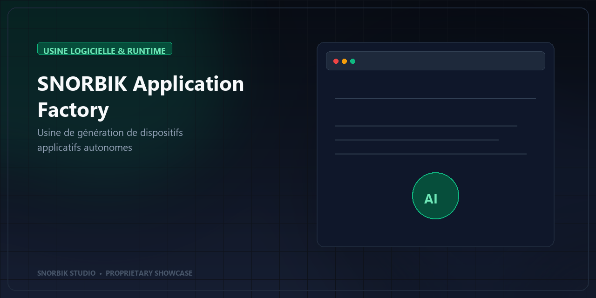

# SNORBIK Application Factory — Usine de Dispositifs Applicatifs Autonomes

> **Accélérez le déploiement de vos solutions intelligentes grâce à une chaîne de fabrication applicative industrielle.**

---

## Vocation du Produit

**SNORBIK Application Factory** est une plateforme logicielle conçue pour industrialiser la production de composants applicatifs autonomes connectés aux capacités d'intelligence artificielle. Elle comble le fossé entre les services techniques et les interfaces utilisateurs finales en générant des modules prêts à l'intégration.

---

## Secteurs & Marchés Concernés

- **Éditeurs de Logiciels & Plateformes SaaS** : Ajout rapide de briques intelligentes dans des applications existantes.
- **Grandes Entreprises & Banques / Assurances** : Déploiement souverain de dispositifs métiers sécurisés.
- **Intégrateurs & ESN** : Standardisation et accélération des livrables IA pour leurs clients.

---

## Bénéfices Clés

- **Time-to-Market Divisé par 5** : Passage immédiat d'une capacité métier à une application fonctionnelle.
- **Architecture Étanche & Réutilisable** : Chaque module produit est autonome, portable et indépendant des environnements d'exécution.
- **Expérience Utilisateur Moderne** : Composants visuels élégants, guidage pas-à-pas et communication fluide.
- **Garantie de Souveraineté** : Maîtrise totale des composants sans dépendance technologique restrictive.

---

## Démonstration Vidéo

🎥 **[Voir la vidéo de présentation du produit](./assets/presentation-video/product-presentation.mp4)**

---

## Découvrir la Solution ou Demander une Démonstration

Cette vitrine présente un aperçu commercial d'une solution propriétaire développée par **SNORBIK Studio**.

- 🌐 **Découvrir l'écosystème SNORBIK :** [Accéder au Portfolio Officiel SNORBIK Studio](https://snorbik.com)
- 📅 **Planifier un échange technique ou commercial :** [Contacter l'équipe SNORBIK Studio](https://snorbik.com/rendez-vous)

---
© 2026 **SNORBIK Studio** — Tous droits réservés. Solution commerciale propriétaire.
